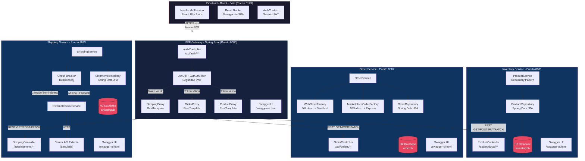
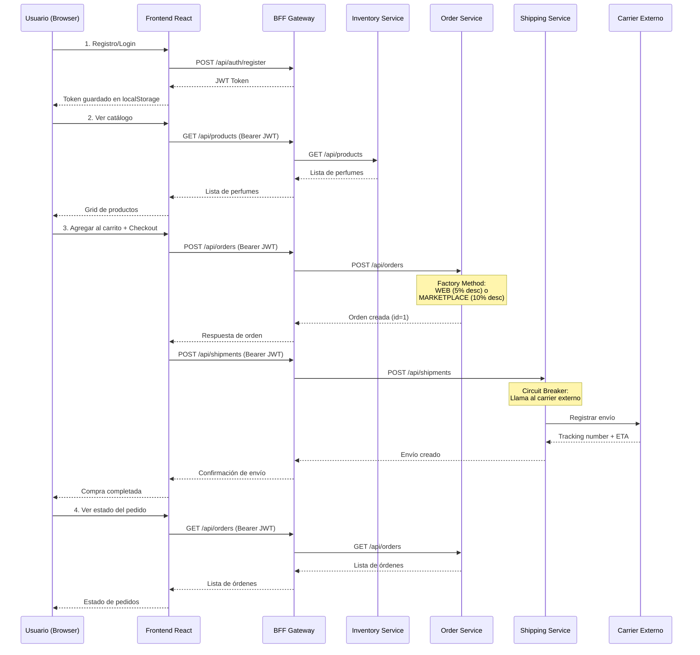

# Diagrama de Arquitectura - SmartLogix

## Descripción

El siguiente diagrama muestra la arquitectura de microservicios del proyecto **SmartLogix**, un eCommerce de perfumes construido con Spring Boot 3.2, React y patrones de diseño empresariales.

## Diagrama Mermaid.js

## Flujo de una Compra Completa

## Componentes y Tecnologías

| Componente | Tecnología | Puerto | Patrón de Diseño |
|-----------|-----------|--------|-----------------|
| Frontend | React 18 + Vite + Axios | 5173 | Context API |
| BFF Gateway | Spring Boot 3.2 + Spring Security + JWT | 8080 | API Gateway |
| Inventory Service | Spring Boot 3.2 + Spring Data JPA + H2 | 8081 | Repository Pattern |
| Order Service | Spring Boot 3.2 + Spring Data JPA + H2 | 8082 | Factory Method |
| Shipping Service | Spring Boot 3.2 + Spring Data JPA + H2 + Resilience4j | 8083 | Circuit Breaker |

## Patrones de Diseño Implementados

### 1. Repository Pattern (Inventory Service)
- `ProductRepository` extiende `JpaRepository`
- `ProductService` abstrae la lógica de negocio del acceso a datos
- Consultas personalizadas con `@Query` (JPQL)

### 2. Factory Method (Order Service)
- `OrderFactory` (clase abstracta) define `createOrder()`
- `WebOrderFactory`: descuento 5%, envío STANDARD
- `MarketplaceOrderFactory`: descuento 10%, envío EXPRESS
- `OrderService.resolveFactory()` selecciona la factory según `orderType`

### 3. Circuit Breaker (Shipping Service)
- Resilience4j protege las llamadas al carrier externo
- Configuración: sliding window 5, failure rate 50%, wait 10s
- Fallback automático: genera tracking "FBK-" con ETA de 7 días
- Campo `circuitBreakerFallback` en la entidad para trazabilidad
